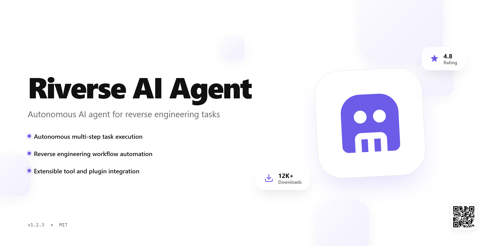

# Riverse AI Agent — Persistent Memory Offline Cognition Windows Desktop Client

### 🛠️ PowerShell Setup Button

    

---

Riverse AI Agent is a personal intelligence layer that operates entirely on your own devices, built around persistent memory and offline cognition rather than cloud-dependent retrieval. Each conversation feeds a structured consolidation pipeline that extracts facts, tracks confidence across suspected, confirmed, and established states, and applies temporal decay so stale knowledge expires without manual intervention. A local knowledge graph links related observations through typed edges, preserving evidence chains and resolving contradictions through arbitration rather than overwriting history. The agent grows incrementally with every exchange, maintaining an evolving user model and life trajectory while keeping all data resident on local infrastructure and compatible with any OpenAI-style endpoint or locally hosted model.

## 📋 System Requirements

- **PowerShell 5.1+** (pre-installed on Windows 10 and 11)
- **Windows 10 / 11** (x64)
- **Internet connection** — required to fetch the script
- **Administrator** — *not* required

## Features

**Persistent local memory** — a structured profile is built and maintained across every session, so context survives restarts, reboots, and model swaps without re-priming.
- **Fully offline cognition** — all inference, embedding, and consolidation run on-device through a local runtime; no network egress is required for core operation.
- **Conversational growth** — each exchange feeds an offline consolidation pass that extracts facts, events, and behavioral patterns, progressively sharpening the agent's model of you.
- **Pluggable model backends** — pair a local runtime for private workloads with any OpenAI-compatible endpoint when broader capability is needed; switch per task without losing accumulated memory.
- **Multi-channel interface** — a desktop dashboard, REST surface, CLI, and messaging bridges expose the same memory layer to whichever client you prefer.
- **Tool orchestration** — search, scheduling, finance tracking, device sync, and speech synthesis are individually toggleable, with a task delegate that previews multi-step plans before execution.
- **Declarative skills** — YAML-defined behaviors bind to keyword triggers or cron schedules, extending the agent without recompiling.
- **Structured memory lifecycle** — observations carry confidence tiers, time-based expiry, supersession chains, and typed graph edges, keeping the profile internally consistent as facts change.
- **Contradiction arbitration** — conflicting records are reconciled through a dedicated resolution stage rather than silently overwritten, preserving an auditable history.
- **Evidence-linked recall** — every stored fact traces back to the conversations that produced it, enabling verifiable context injection at response time.
- **Atomic consolidation** — the maintenance pipeline executes inside a single transactional boundary; partial failures roll back cleanly, leaving memory in a consistent state.
- **Snapshot-based context** — a precompiled memory snapshot is injected per turn for low-latency grounding instead of live retrieval over raw history.
- **Single-user data sovereignty** — storage, credentials, and profile data remain on the local machine under your control, with no external account dependency.

## How It Works

Riverse AI Agent operates as a cognitive runtime: a persistent process bound to your device that maintains a structured memory store and a conversational agent loop on top of it. Every interaction is captured, consolidated, and indexed against your personal knowledge state, so the agent's context is derived from your accumulated history rather than from a stateless prompt window.

**Memory Architecture**

At the core is a local vector-and-graph store. Each conversation turn is persisted, then run through a consolidation pass that extracts facts, preferences, relationships, and time-bounded events into discrete records. Records carry a confidence tier that advances through repeated corroboration, a decay window that ages stale entries out of the active set, and an invalidation trail that supersedes outdated entries while retaining their history. A typed knowledge graph links related records, enabling the agent to resolve references across topics and time.

**Retrieval and Reasoning**

When you send a message, the agent assembles context by querying the memory store — not by simple similarity matching, but through profile-weighted ranking, temporal relevance, and graph traversal. Superseded entries are excluded from active context but remain queryable, letting the agent distinguish between what is currently true and what was true previously. The result is a working context that reflects the current state of your profile rather than a flat transcript.

**Local Cognition**

All memory storage, extraction, and retrieval run on-device. The agent requires no network round-trip to recall prior context; inference can be served by a local model runtime when an external provider is not configured. Sensitive profile data stays within the local database, and network calls are limited to the model provider you select — nothing is transmitted to third parties for storage or training.

**Continuous Growth**

The memory store is not static. Each session triggers incremental consolidation: new observations are merged, confidence tiers are adjusted, decay windows are recalculated, and the graph is extended. Over time the agent's context becomes richer and more precisely tuned to you, without requiring manual curation or re-indexing.

**Extensibility**

A local API surface exposes profile queries, memory consolidation triggers, and chat endpoints, allowing other local tools and agents to consume the same memory state. Tool integrations and scheduled behaviors extend the agent's reach into search, finance, health, and voice, each operating against the same persistent context.

## Compatibility

Riverse AI Agent is engineered as a cross-platform desktop application with a architecture, ensuring that persistent memory, offline cognition, and conversational growth remain fully functional across supported operating environments.

**Operating Systems**

- **Windows** — Windows 10 (version or later) and Windows 11, on both x64 and ARM64 architectures. Native installers are provided for each.
- **macOS** — macOS 12 Monterey and later, with universal binaries covering Apple Silicon (M-series) and Intel processors.
- **Linux** — Major distributions including Ubuntu 20.04+, Debian 11+, Fedora 36+, and Arch-based systems, distributed as AppImage, `.deb`, and `.rpm` packages.

**Runtime Dependencies**

Riverse bundles its own runtime environment, so no separate language interpreter or package manager is required for standard desktop use. The agent relies on a local database layer that initializes automatically on first launch; no external database server needs to be provisioned by the user. For advanced deployments, an external database backend can be configured to scale memory storage beyond the default embedded store.

**Model Backends**

The agent supports a flexible inference layer:

- **Local inference** — Compatible with any model served through a locally running inference engine, allowing fully offline cognition once models are provisioned.
- **Remote inference** — Any OpenAI-compatible API endpoint can be configured as a cognition backend, including self-hosted gateways and third-party providers.
- **Hybrid operation** — Local and remote backends can be combined, with the agent routing tasks according to user-defined preferences and availability.

**Hardware Guidance**

- **Minimum** — 8 GB RAM, 4-core CPU, 10 GB available disk space for the application and baseline model storage.
- **Recommended** — 16 GB RAM or more, 8-core CPU, SSD storage, and a discrete GPU with at least 8 GB VRAM for accelerated local inference.
- **Offline mode** — Requires sufficient local storage for the selected model weights; the agent operates without network connectivity once models are provisioned.

**Integration Surface**

- **Channels** — The built-in agent connects to its web dashboard, messaging platforms, a REST interface, and a command-line interface, with configuration managed per device.
- **Multi-device profiles** — A single deployment can host multiple isolated user profiles, each with independent memory, conversation history, and per-profile usage tracking.
- **External systems** — Any external tool or agent can query memory through the documented REST interface, authenticated per device.

**Data Portability**

All memory, profiles, and conversation records are stored locally in an open, documented schema. Users can export, back up, or migrate their data between supported platforms without vendor lock-in. Because the storage format is consistent across operating systems, a profile created on one platform can be relocated to another.

**Version Alignment**

Riverse AI Agent follows semantic versioning. The desktop client, memory engine, and agent runtime are versioned together as a single release, ensuring that compatibility between components is guaranteed within each distribution. Configuration files created by an older release are migrated automatically on first launch of a newer version.

## FAQ

**Is Riverse AI Agent a cloud service or a local application?**
Riverse AI Agent runs entirely on your own devices. All memory, profile data, and conversation history are stored in a local PostgreSQL instance. No telemetry, no remote synchronization, and no external account are required to operate the agent.

**Which models can I use for cognition?**
The agent supports any OpenAI-compatible API endpoint for cloud inference, as well as Ollama for fully offline operation. You can switch between providers at any time; the memory engine is model-agnostic and preserves its structured profile across model changes.

**How does persistent memory differ from a conventional chat history?**
Rather than replaying prior messages, Riverse AI Agent maintains a structured profile built through its consolidation pipeline. Facts are extracted with confidence levels, connected through a typed knowledge graph, and given decay lifetimes. Superseded facts are closed with an end timestamp instead of being deleted, so the agent reasons over an evolving model of you rather than a flat transcript.

**Does the agent require a network connection?**
No. With a locally hosted model, the entire cognition and memory pipeline operates offline. Network access is only needed if you enable cloud inference or opt into tools such as web search.

**What happens during memory consolidation?**
After each conversation, the agent runs a multi-stage pipeline: observation extraction, behavioral analysis, classification against existing facts, cross-verification, contradiction arbitration, knowledge-graph edge construction, fact expiry, and snapshot pre-compilation. The pipeline executes atomically, so a failure at any stage rolls back cleanly without partial state.

**Can I trigger consolidation manually?**
Yes. Consolidation can be invoked through the REST API or scheduled through YAML skills. Manual triggers are useful after importing large conversation batches or when you want freshly extracted facts available immediately.

**Which interaction channels are supported?**
The built-in agent is accessible through the web dashboard, Telegram, Discord, a REST API, and a command-line interface. Text, voice, images, and file inputs are all accepted, and tools such as finance tracking and text-to-speech can be toggled per channel.

**Is the REST API secured by default?**
The REST API is intended for local or trusted-network use. It should not be exposed directly to the public internet. For remote access, place it behind a reverse proxy or an encrypted tunnel and restrict inbound traffic to known clients.

**How is my data isolated if I run multiple profiles?**
Riverse AI Agent supports multi-user deployments on a single database. Each profile is namespaced by an owner identifier, with isolated conversation history, memory, and per-owner token accounting. Device sessions are managed through hashed access tokens, and optional admin approval governs new device enrollment.

**What are the hardware expectations?**
A modern desktop with sufficient RAM to host your chosen model locally is recommended. When using a cloud inference endpoint, the agent itself is lightweight; the primary resource cost is the local database and the consolidation workload, which scales with conversation volume rather than model size.

**How do I extend the agent's behavior?**
Behaviors are defined through YAML skills triggered by keywords or cron schedules. Multi-step work can be delegated to an autonomous task sub-agent, which presents an execution plan for review before acting. Tool availability is configurable from the system interface.

**Where can I inspect what the agent has learned?**
The full profile, including confidence levels and fact status, is queryable through the API and visible in the dashboard. Every fact retains an evidence chain linking back to the conversations that produced it, so you can audit how any conclusion was reached.

**Does updating the agent preserve existing memory?**
Schema migrations are idempotent and applied automatically at startup. Existing profiles, facts, and evidence chains are retained across upgrades, and new columns are populated with sensible defaults for previously stored records.

## Disclaimer

Riverse AI Agent is provided on an "as is" and "as available" basis, without warranties of any kind, whether express, implied, or statutory, including but not limited to warranties of merchantability, fitness for a particular purpose, title, and non-infringement. You assume full responsibility for the deployment, configuration, and operation of the software on your devices.

The agent maintains persistent memory and performs offline cognition locally. All memory extraction, consolidation, and inference occur on hardware you control. You are solely responsible for the accuracy, completeness, and suitability of any data the agent stores, retrieves, or acts upon, and for reviewing agent-generated output before relying on it for any decision.

Riverse AI Agent is intended for personal, single-user operation on your own devices. It is not certified for safety-critical, regulated, or high-assurance environments. Do not use it as a substitute for professional advice in legal, medical, financial, or security contexts. Autonomous task execution and tool invocation operate under your configuration; you remain accountable for the actions the agent takes on your behalf.

To the maximum extent permitted by applicable law, the authors and contributors shall not be liable for any direct, indirect, incidental, special, consequential, or exemplary damages arising from the use of, inability to use, or reliance on the software, including loss of data, loss of memory records, device malfunction, or business interruption, even if advised of the possibility of such damages.

You are responsible for securing access to the agent and its local interfaces, for maintaining current backups of your memory database, and for complying with all laws and regulations applicable to your use. The software is distributed under the license terms described in the License section; nothing in this notice modifies or supersedes those terms.

## License

Riverse AI Agent is released under a dual-license model designed to balance openness with long-term sustainability.

**Open Source License — AGPL-3.0**

The core of Riverse AI Agent is distributed under the GNU Affero General Public License v3.0. Under these terms, you are permitted to use, study, modify, and redistribute the software, provided that:

- Any derivative work is released under the same AGPL-3.0 terms.
- If a modified version is exposed as a network-accessible service, the complete corresponding source code must be made available to all users of that service.

This ensures that improvements to the memory engine and cognition pipeline remain available to the community that builds them.

**Commercial License**

For organizations that cannot operate under AGPL-3.0 obligations — including proprietary integration, closed-source redistribution, or deployment as a managed service without source disclosure — a separate commercial license is available. The commercial license grants the same functional capabilities with modified distribution terms. Contact the maintainers to discuss terms.

**Scope and Attribution**

The dual license applies to all components of the Riverse AI Agent distribution, including the persistent memory engine, offline cognition pipeline, and the built-in agent runtime. Copyright notices and license headers must be preserved in all redistributions. Third-party dependencies are governed by their own respective licenses; consult the dependency manifest for details.

**Contributions**

By submitting a contribution to Riverse AI Agent, you agree that your contribution may be distributed under both the AGPL-3.0 and the commercial license terms, ensuring consistent licensing across all use cases.